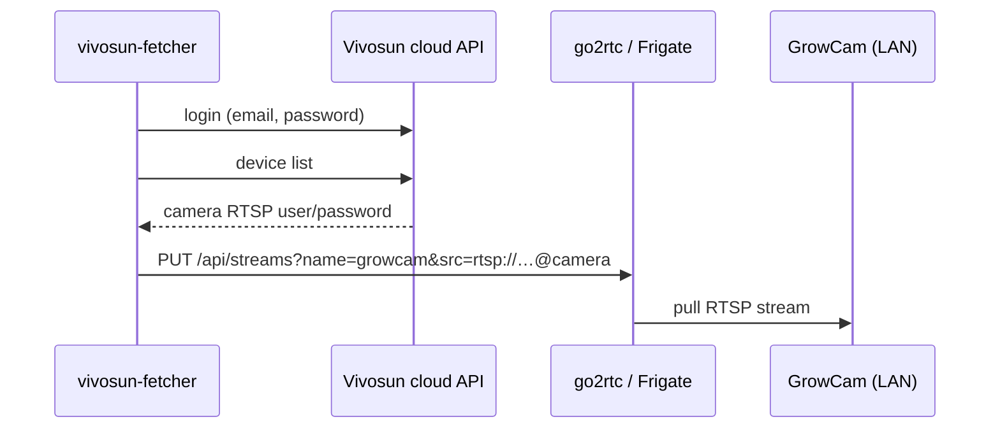

# vivosun-fetcher

Keeps the RTSP stream of a **VIVOSUN GrowCam C4** working in
[go2rtc](https://github.com/AlexxIT/go2rtc) and [Frigate](https://frigate.video).

The camera's RTSP credentials are only available through the Vivosun cloud. This
service logs in to the Vivosun API, reads the camera's LAN credentials, and pushes the
RTSP source into one or more go2rtc servers via their stream API. It re-checks every
minute (go2rtc forgets API-created streams on restart) and does a full refresh every
6 hours. Credentials are never logged.

## How it works



## Configuration

All settings are environment variables, see [`.env.example`](.env.example).

## Run

```bash
cp .env.example .env && chmod 600 .env   # fill in
docker compose up -d                     # or: scripts/docker-run.sh
```

The container runs as a non-root user with a read-only filesystem and no capabilities.

## Images

Built by GitHub Actions and published to GHCR:

| Branch | Image |
|---|---|
| `dev` | `ghcr.io/igridz/vivosun-fetcher:dev` (testing) |
| `main` | `ghcr.io/igridz/vivosun-fetcher:latest` |

No third-party Python dependencies — standard library only.

## Workflow

`feature/*` → PR into `dev` (builds `:dev`) → test → PR `dev` → `main` (builds `:latest`).
